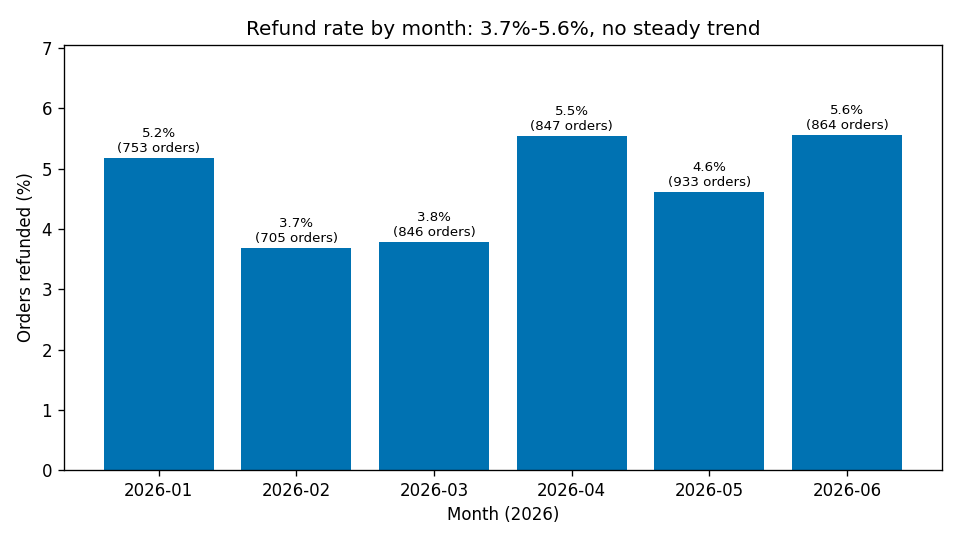
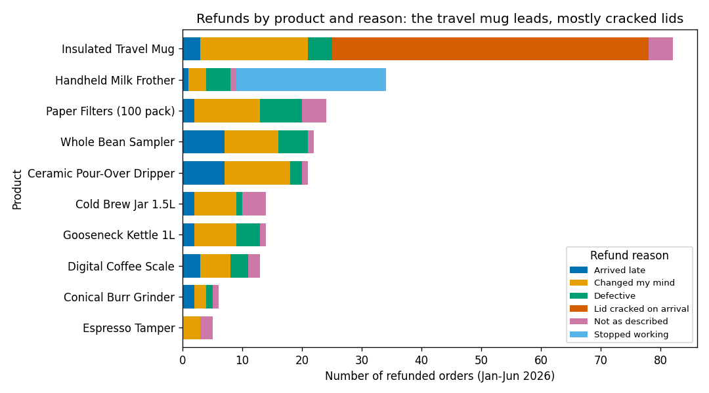
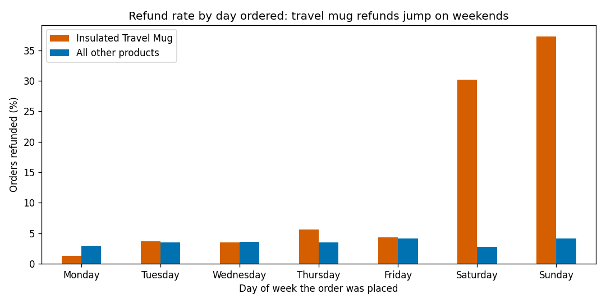
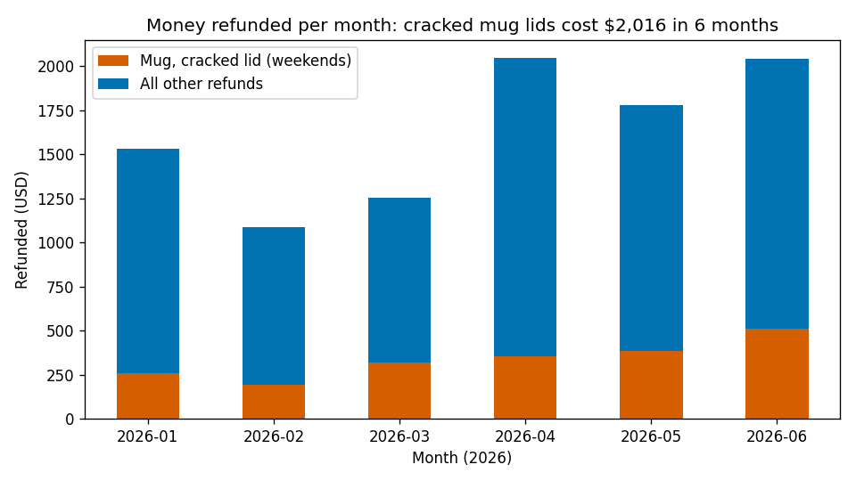

# Bean & Kettle orders, Jan–Jun 2026: findings

**Main finding:** Insulated Travel Mugs ordered on a **Saturday or Sunday** come back with **"Lid cracked on arrival"**. That happened 53 times (all on weekends, never on weekdays, never for any other product) and cost **$2,016** in refunds.

## 1. Orders, revenue and refunds

- **4,948 orders**, **$230,542** revenue.
- **235 orders (4.7%) refunded**, $9,740 paid back.
- Monthly rate moves between 3.7% (Feb) and 5.6% (Jun), no steady trend. The cracked-lid problem appears every month (6–11 refunds), so it is ongoing.

## 2. Products and reasons

| Product | Orders | Refunds | Rate | Top reason |
| --- | --- | --- | --- | --- |
| Insulated Travel Mug | 597 | 82 | 13.7% | Lid cracked on arrival (53) |
| Handheld Milk Frother | 373 | 34 | 9.1% | Stopped working (25) |
| Each other product | 279–788 | 5–24 | 1.7–4.0% | Changed my mind |

All reasons: Changed my mind 76, Lid cracked on arrival 53, Defective 31, Arrived late 29, Stopped working 25, Not as described 21.

## 3. Day of the week

Overall, weekend orders are refunded more (Sat 6.1%, Sun 8.3% vs 2.8–4.2% on weekdays). But that is **only the travel mug**:

- Travel mug: 3.8% on weekdays vs **33.8% on weekends** (67 of 198 weekend orders).
- All other products: 3.6% on weekdays vs 3.4% on weekends — no difference.

## 4. The unusual part

- **Product:** Insulated Travel Mug ($32).
- **Days:** Saturday (24) and Sunday (29) orders only.
- **Reason:** "Lid cracked on arrival" — no other product ever gets this reason.
- **Cost:** $2,016, about 21% of all refund money. Without it, the shop's refund rate would be 3.7% instead of 4.7%.
- It is spread across all regions and channels, so it likely comes from how weekend orders are packed or shipped.

Smaller, separate issue: Milk Frother "Stopped working" refunds (25, $1,395), steady every month, any day.

## What to do next

1. Check how weekend orders are packed and shipped (staff, packing station, courier pickup), and add lid protection to mug packaging now.
2. Raise the Milk Frother failures with the supplier.

Rerun with `python3 reports/analysis.py`.
